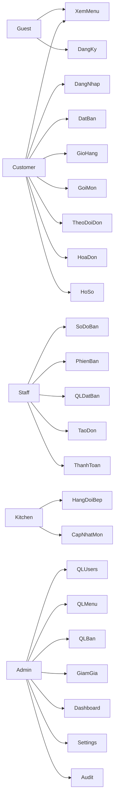

# Use Case Diagram — RMS

Hệ thống quản lý nhà hàng. Actor: **Guest** (chưa login), **Customer**, **Staff**, **Kitchen**, **Admin**.

Ảnh nằm trong `docs/diagrams/` (PNG). Vẽ lại bằng `docs/diagrams/render_uc.py` khi cần đồng bộ.

**Luồng khách đã chốt:** xem menu → đăng nhập → đặt bàn → staff check-in → gọi món / giỏ hàng. **Không** gọi món bằng QR khách. **Không** CRM VIP/điểm (ngoài scope học).

## 1. Tổng quan




## 2. Guest & Customer


| ID | Use case | Actor |
| --- | --- | --- |
| UC-01 | Đăng ký tài khoản | Guest → Customer |
| UC-02 | Đăng nhập | Customer (+ các vai khác) |
| UC-03 | Làm mới access token | Đã đăng nhập |
| UC-04 | Đăng xuất | Đã đăng nhập |
| UC-05 | Xem / sửa hồ sơ | Customer |
| UC-06 | Xem thực đơn công khai | Guest, Customer, Staff |
| UC-07 | Đặt bàn | Customer (đã login) |
| UC-08 | Xem / hủy đặt bàn của mình | Customer |
| UC-09 | Thêm món vào giỏ hàng | Customer (đã login) |
| UC-10 | Quản lý giỏ / đặt món từ giỏ | Customer (sau check-in) |
| UC-11 | Đặt ngay một món | Customer (sau check-in) |
| UC-12 | Theo dõi đơn của mình | Customer |
| UC-13 | Xem / tải hóa đơn PDF | Customer, Staff, Admin |

**Quy tắc nghiệp vụ**

- Guest: chỉ **xem thực đơn** (+ đăng ký).
- Customer: **đặt bàn** sau khi đăng nhập.
- **Gọi món** (giỏ hoặc đặt ngay) chỉ khi đặt bàn đã **CHECKED_IN** và có `table_session` OPEN (staff check-in).
- Không có actor / use case **Gọi món qua QR** cho khách (`qr.html` chỉ stub → `menu.html`).

## 3. Staff


| ID | Use case |
| --- | --- |
| UC-14 | Xem sơ đồ bàn (màu trạng thái, **timer ngồi**, **lọc khu vực**) |
| UC-15 | Mở / đóng phiên bàn (walk-in) |
| UC-16 | Xác nhận / từ chối / check-in / hoàn tất / no-show đặt bàn |
| UC-17 | Tạo và chỉnh đơn phục vụ (walk-in / hỗ trợ) |
| UC-18 | Ghi nhận thanh toán (tiền mặt / CK) + mở hóa đơn PDF |
| UC-19 | Xem hàng đợi bếp (tuỳ quyền STAFF) |

Check-in đặt bàn **tự mở** `table_session` OPEN để customer gọi món.

## 4. Kitchen


| ID | Use case |
| --- | --- |
| UC-20 | Xem hàng đợi bếp (REST + realtime STOMP) |
| UC-21 | Cập nhật trạng thái từng món (`PENDING` → `PREPARING` → `READY`) |

## 5. Admin


| ID | Use case |
| --- | --- |
| UC-22 | Quản lý người dùng và vai (tạo STAFF/KITCHEN, gán role, khóa/mở) |
| UC-23 | Quản lý danh mục |
| UC-24 | Quản lý món (+ upload ảnh) |
| UC-25 | Quản lý bàn (CRUD; schema QR giữ, không dùng cho luồng khách) |
| UC-26 | Quản lý giảm giá |
| UC-27 | Cài đặt nhà hàng (thuế, thời lượng đặt bàn) |
| UC-28 | Dashboard / báo cáo (overview + **biểu đồ** doanh thu theo ngày / giờ cao điểm) |
| UC-29 | Xem audit log |

**Ngoài scope học (không có trên diagram):** CRM VIP/điểm, HĐĐT nghị định, kho nguyên liệu, POS offline / máy in.

## 6. Include / extend

```text
Đặt bàn ──<<include>>──► Đăng nhập

Gọi món / Đặt từ giỏ ──<<include>>──► Đặt bàn đã CHECKED_IN
Gọi món / Đặt từ giỏ ──<<include>>──► Phiên bàn OPEN
Gọi món ──<<include>>──► Xem thực đơn
Gọi món ──<<extend>>──► Áp mã giảm giá
Thêm giỏ ──<<extend>>──► Đặt món từ giỏ

QL đặt bàn / check-in ──<<include>>──► Mở table_session OPEN
Tạo đơn (Staff) ──<<include>>──► Phiên bàn đang mở
Thanh toán ──<<include>>──► Đơn cho phép thanh toán (SERVED)
Thanh toán ──<<extend>>──► Xuất hóa đơn PDF

Cập nhật món bếp ──<<include>>──► Đơn trong hàng đợi
Cập nhật món bếp ──<<extend>>──► Đẩy sự kiện realtime STOMP
```

## 7. File ảnh

| File | Nội dung |
| --- | --- |
| `diagrams/uc-overview.png` | Tổng quan mọi actor (không QR khách; có timer bàn + chart dashboard) |
| `diagrams/uc-customer.png` | Guest + Customer (giỏ / gọi món sau check-in) |
| `diagrams/uc-staff.png` | Staff (sơ đồ timer/khu vực, check-in → session) |
| `diagrams/uc-kitchen.png` | Kitchen |
| `diagrams/uc-admin.png` | Admin (dashboard biểu đồ; ghi chú ngoài scope) |

Tái tạo PNG:

```bash
cd docs/diagrams && python3 render_uc.py
```
