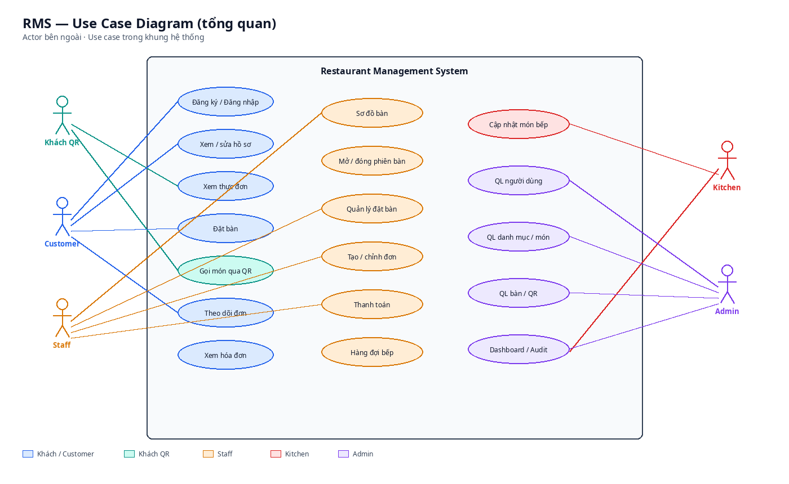
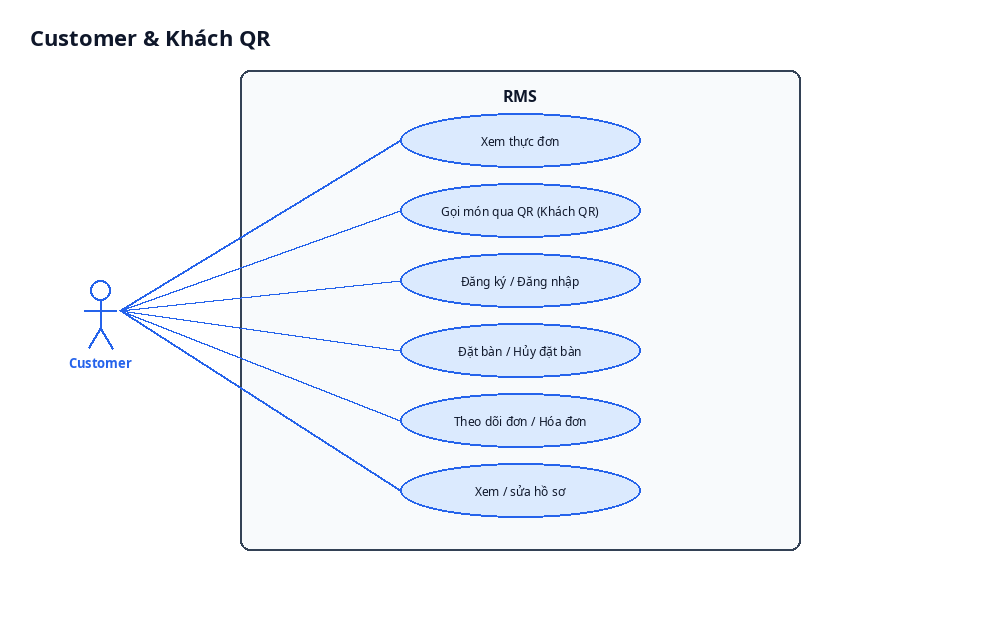
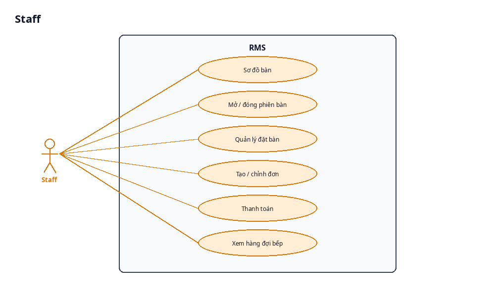
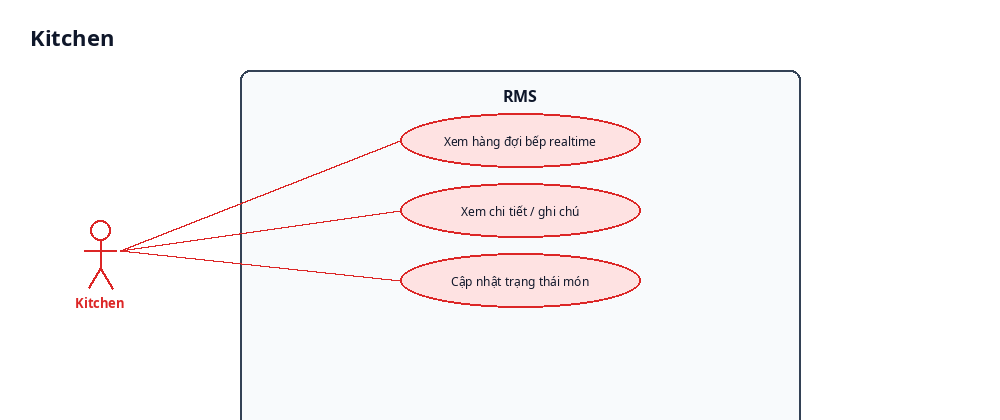
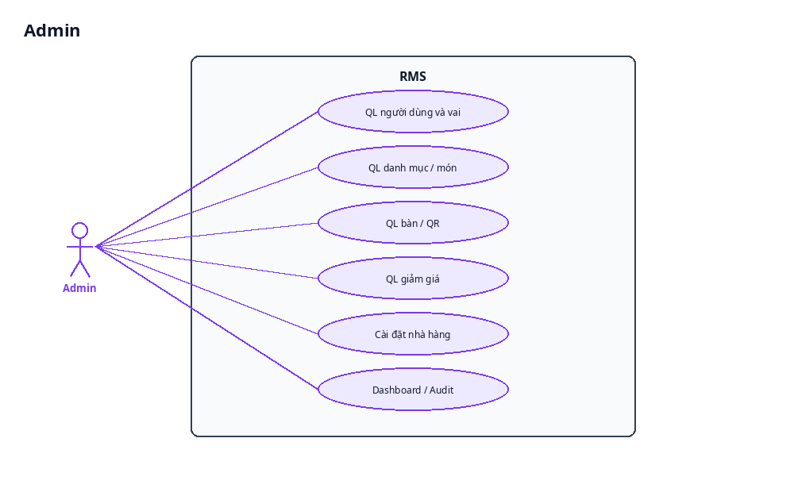

# Use Case Diagram — RMS

Hệ thống quản lý nhà hàng. Actor: **Khách QR**, **Customer**, **Staff**, **Kitchen**, **Admin**.

Ảnh nằm trong `docs/diagrams/` (PNG).

## 1. Tổng quan



## 2. Customer & Khách QR



| ID | Use case | Actor |
| --- | --- | --- |
| UC-01 | Đăng ký tài khoản | Customer |
| UC-02 | Đăng nhập | Customer (+ các vai khác) |
| UC-03 | Làm mới access token | Đã đăng nhập |
| UC-04 | Đăng xuất | Đã đăng nhập |
| UC-05 | Xem / sửa hồ sơ | Customer |
| UC-06 | Xem thực đơn công khai | Khách QR, Customer, Staff |
| UC-07 | Đặt bàn | Customer |
| UC-08 | Xem / hủy đặt bàn của mình | Customer |
| UC-09 | Gọi món qua QR | Khách QR |
| UC-10 | Theo dõi đơn của mình | Customer |
| UC-11 | Xem / tải hóa đơn | Customer, Staff, Admin |

## 3. Staff



| ID | Use case |
| --- | --- |
| UC-12 | Xem sơ đồ bàn |
| UC-13 | Mở / đóng phiên bàn |
| UC-14 | Xác nhận / từ chối / check-in / hoàn tất đặt bàn |
| UC-15 | Tạo và chỉnh đơn phục vụ |
| UC-16 | Ghi nhận thanh toán |

## 4. Kitchen



| ID | Use case |
| --- | --- |
| UC-17 | Xem hàng đợi bếp (realtime) |
| UC-18 | Cập nhật trạng thái từng món |

## 5. Admin



| ID | Use case |
| --- | --- |
| UC-19 | Quản lý người dùng và vai |
| UC-20 | Quản lý danh mục |
| UC-21 | Quản lý món |
| UC-22 | Quản lý bàn và QR |
| UC-23 | Quản lý giảm giá |
| UC-24 | Cài đặt nhà hàng |
| UC-25 | Dashboard / báo cáo |
| UC-26 | Xem audit log |

## 6. Include / extend

```text
Gọi món QR ──<<include>>──► Xác thực token QR bàn
Gọi món QR ──<<include>>──► Xem thực đơn
Gọi món QR ──<<extend>>──► Áp mã giảm giá

Tạo đơn (Staff) ──<<include>>──► Phiên bàn đang mở
Thanh toán ──<<include>>──► Đơn cho phép thanh toán
Thanh toán ──<<extend>>──► Xuất hóa đơn

Cập nhật món bếp ──<<include>>──► Đơn trong hàng đợi
Cập nhật món bếp ──<<extend>>──► Đẩy sự kiện realtime
```

## 7. File ảnh

| File | Nội dung |
| --- | --- |
| `diagrams/uc-overview.png` | Tổng quan mọi actor |
| `diagrams/uc-customer.png` | Customer + Khách QR |
| `diagrams/uc-staff.png` | Staff |
| `diagrams/uc-kitchen.png` | Kitchen |
| `diagrams/uc-admin.png` | Admin |

